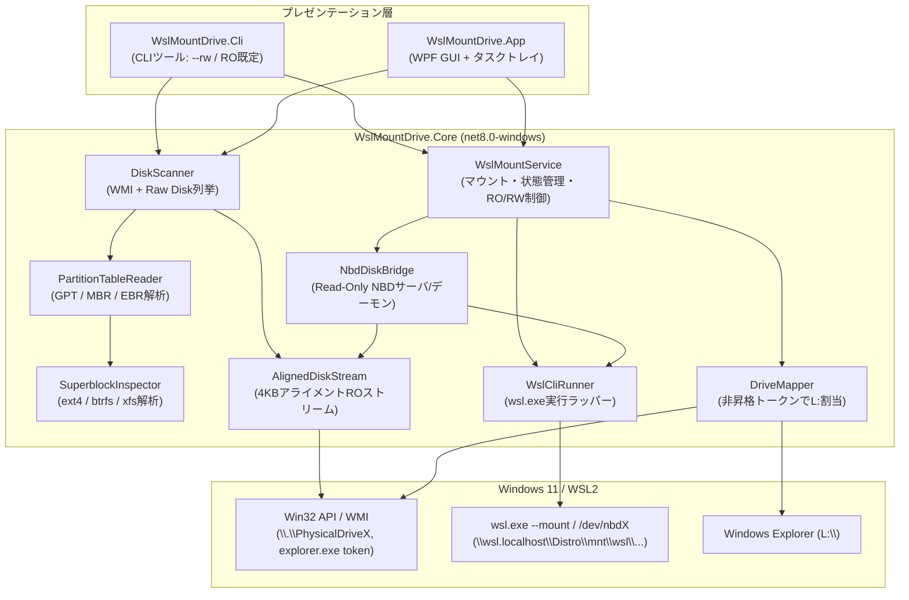
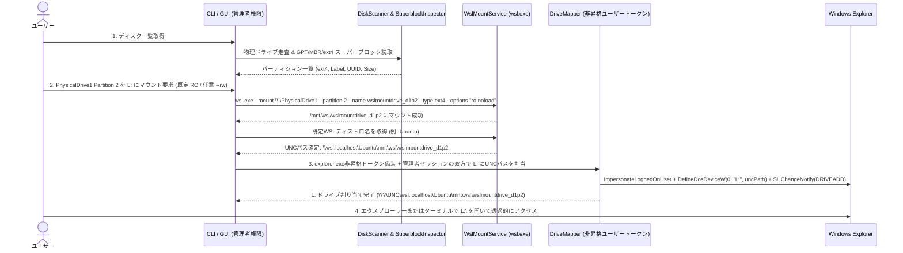

# システムアーキテクチャ設計書 (`WslMountDrive`)

本ドキュメントは **WslMountDrive** の現行システム構成、コンポーネント責務、主要データフロー、スーパーブロック解析仕様、および境界設計を定義します。個別の設計判断理由（なぜ他案ではなく本方式を採ったか）は [adr/README.md](adr/README.md) に記録しています。

## 1. 全体構成図

### ソリューション・ディレクトリ構成

```text
WslMountDrive/
├── WslMountDrive.sln
├── README.md                             # 英語メイン README
├── README.ja.md                          # 日本語 README (1:1 ミラー)
├── LICENSE                               # MIT License
├── CHANGELOG.md / CONTRIBUTING.md / SECURITY.md / AGENTS.md
├── .github/                              # CI / Release ワークフロー・Issue/PR テンプレート
├── scripts/                              # build-and-test.ps1 等ヘルパースクリプト
├── docs/                                 # 設計・要件・ガイド・ADR・テストドキュメント
├── src/
│   ├── WslMountDrive.Core/                    # 共通コアライブラリ (net8.0-windows)
│   │   ├── Models/
│   │   │   ├── LinuxFileSystemType.cs    # FS 種別列挙体 (Ext2/3/4, Btrfs, Xfs 等)
│   │   │   ├── PartitionEntry.cs         # パーティション情報 (開始オフセット/FS/Label/UUID)
│   │   │   ├── PhysicalDiskEntry.cs      # 物理ディスク情報 (Index/Model/Style/Partitions)
│   │   │   ├── MountRequest.cs           # マウント要求パラメータ (RO/RW, NoLoad, NBD 等)
│   │   │   └── MountSession.cs           # マウント済みセッション情報 (AccessModeDisplay 等)
│   │   ├── Disk/
│   │   │   ├── AlignedDiskStream.cs      # セクタ境界(4KB)アライメント・キャッシュ付 Read 専用 Stream
│   │   │   ├── SuperblockInspector.cs    # ext2/3/4, btrfs, xfs, LUKS, swap スーパーブロック解析
│   │   │   ├── PartitionTableReader.cs   # MBR / EBR / GPT / Raw FS イメージ解析
│   │   │   └── DiskScanner.cs            # WMI + Raw Disk 走査 ＆ イメージファイル解析
│   │   ├── Wsl/
│   │   │   ├── WslCliRunner.cs           # wsl.exe 実行 & UTF-16LE/UTF-8 自動デコード
│   │   │   ├── NbdDiskBridge.cs          # Windows 同居ディスク向け Read-Only NBD ブリッジ
│   │   │   └── WslMountService.cs        # wsl --mount / --unmount / NBD ブリッジ / /proc/mounts 照会
│   │   └── Interop/
│   │       ├── NativeMethods.cs          # Win32 API P/Invoke 定義
│   │       └── DriveMapper.cs            # UAC 透過ドライブレター割当・解除・Explorer 通知
│   ├── WslMountDrive.Cli/                     # コンソールアプリ (list / mount / unmount / status)
│   └── WslMountDrive.App/                     # WPF GUI + タスクトレイアプリ (app.manifest で管理者昇格)
└── tests/
    └── WslMountDrive.Tests/                   # xUnit 単体テスト
```

### コンポーネント関連図



## 2. コンポーネント構成と責務

| モジュール / パス | 責務 | 依存制約 / 不変条件 |
| :--- | :--- | :--- |
| `src/WslMountDrive.Core/Disk/` | 物理ディスク・イメージの読み取り専用走査と MBR/EBR/GPT/スーパーブロック解析 | 必ず `GENERIC_READ` で開き、書き込み API を一切持たない |
| `src/WslMountDrive.Core/Wsl/` | `wsl.exe` 実行、`/proc/mounts` からのステートレス復元、RO/RW 引数構築、NBD ブリッジ制御 | 既定は `ro,noload`（`ReadWrite == false`）、NBD 経路では RW 禁止、最後の一括解除前は WSL 内 `umount` を先行させない |
| `src/WslMountDrive.Core/Interop/` | Win32 P/Invoke と `DefineDosDeviceW` + トークン偽装によるドライブレター割当・解除 | 偽装後必ず `RevertToSelf()` を実行し、通常ユーザー・管理者双方のセッションに反映する |
| `src/WslMountDrive.Cli/` | サブコマンド（`list` / `mount` / `unmount` / `status`）と NBD 常駐サブプロセス（`__nbd-daemon`） | `WslMountDrive.Core` のみに依存し、テスト可能なサービス層を呼び出す |
| `src/WslMountDrive.App/` | WPF 操作画面と WinForms システムトレイ管理 | `app.manifest` で管理者昇格を要求し、非昇格起動時は再起動ボタンを提供する |
| `tests/WslMountDrive.Tests/` | モック（`IWslCommandRunner` / `INbdBridgeProvider`）と合成ストリームによる自動単体テスト | 実機 WSL や実ディスクに依存せず CI 上で高速実行できる |

## 3. 主要データフローと状態遷移

### マウント処理シーケンス（既定 Read-Only 例）



### スーパーブロック・バイナリ解析仕様 (`SuperblockInspector`)

`wsl --mount` を実行する前からパーティション情報を高精度に表示するため、コアライブラリでは以下のオフセット定義で読み取り専用の直接解析を行います。

1. **ext2 / ext3 / ext4**:
   - パーティション先頭から `+1024` バイト地点に 1024 バイトのスーパーブロックが存在。
   - `+0x38` (2 bytes, LE): マジックナンバー `0xEF53`
   - `+0x5C` (4 bytes, LE): `s_feature_compat` (`0x0004` = `HAS_JOURNAL`)
   - `+0x60` (4 bytes, LE): `s_feature_incompat` (`0x0040` = `EXTENTS`, `0x0080` = `64BIT`)
   - `+0x64` (4 bytes, LE): `s_feature_ro_compat` (`> 0x0007` の追加機能で ext4 判定)
   - `+0x68` (16 bytes): `s_uuid`（ビッグエンディアン標準 UUID 表記へ変換）
   - `+0x78` (16 bytes): `s_volume_name`（UTF-8 Null 終端ボリュームラベル）
2. **Btrfs**:
   - パーティション先頭から `+0x10000` (64KiB) 地点。
   - `+0x40` (8 bytes): マジック文字列 `"_BHRfS_M"`
   - `+0x20` (16 bytes): `fsid` (UUID)
   - `+0x12B` (256 bytes): ボリュームラベル
3. **XFS**:
   - パーティション先頭 `+0x00`。
   - `+0x00` (4 bytes): マジック文字列 `"XFSB"`
   - `+0x20` (16 bytes): `sb_uuid`
   - `+0x6C` (12 bytes): `sb_fname` (ボリュームラベル)

## 4. 信頼境界・セキュリティ境界

- **プロセス / 権限境界**: `\\.\PhysicalDriveX` への生アクセスと `wsl --mount` は管理者トークン（`requireAdministrator`）で行い、ユーザー向けドライブシンボリックリンクの公開時のみ `explorer.exe` 非昇格トークンを一時的に偽装（`ImpersonateLoggedOnUser` → `DefineDosDeviceW` → `RevertToSelf`）します。
- **読み取り専用境界（NBD ブリッジ）**: Windows 使用中ディスクに対する NBD ブリッジは、`GENERIC_READ` のみ・パーティション範囲 `[OffsetBytes, OffsetBytes + SizeBytes)` 限定の `AlignedDiskStream`、書き込み系 NBD コマンドへ `EROFS (30)` を返す `ReadOnlyNbdServer`、および WSL 側 `-o ro,noload` / `ro` マウントの 3 重防御を強制します。

## 5. 関連 ADR 索引

設計上の主要なトレードオフおよび Windows 11 / WSL2 固有課題の解決策は [adr/README.md](adr/README.md) に独立して記録しています。

| ADR ID | タイトル | 概要 |
| :--- | :--- | :--- |
| [ADR-0001](adr/0001-wsl2-mount-over-user-mode-fs-drivers.md) | WSL2 (`wsl --mount`) 方式の採用 | Dokan/WinFsp を使わず WSL2 純正カーネルドライバを採用した理由 |
| [ADR-0002](adr/0002-define-dos-device-and-uac-token-impersonation.md) | `DefineDosDeviceW` と非昇格トークン偽装 | `p9np.dll` 2階層制限（エラー64/67）と UAC セッション分離の回避設計 |
| [ADR-0003](adr/0003-default-ro-noload-with-optional-rw.md) | 既定 `ro,noload` 保護と任意 RW オプション | Dirty ext4 の安全な保護と `--rw` / GUI 切替、モード不一致防止 |
| [ADR-0004](adr/0004-wsl-unmount-ordering-and-multi-partition-management.md) | `wsl --unmount` 実行順序とマルチパーティション制御 | `WSL_E_DISK_ALREADY_MOUNTED` 回避・兄弟パーティション同時マウント管理 |
| [ADR-0005](adr/0005-read-only-nbd-bridge-for-windows-shared-disks.md) | Windows 同居ディスク向け Read-Only NBD ブリッジ | `ERROR_SHARING_VIOLATION` 回避のための 3 重 RO 保護 `/dev/nbdX` ブリッジ |
