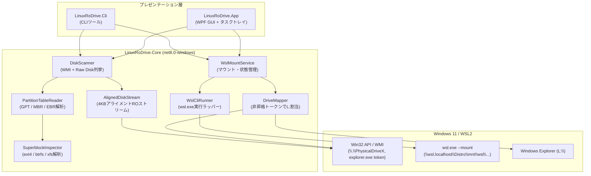
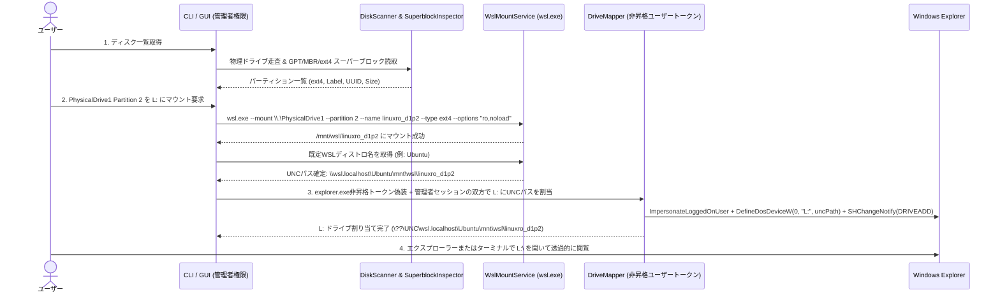

# LinuxRoDrive アーキテクチャ設計・開発計画書

Windows 11上で、別ドライブにあるLinuxパーティション（`ext4` / `btrfs` / `xfs` 等）をRead-Only（読み取り専用）で安全にマウントし、エクスプローラーから通常のドライブレター（`L:\` など）として透過的にアクセスできるユーティリティ **`LinuxRoDrive`** の要件定義・設計・実装計画書です。

---

## 1. 背景とアプローチ選定

Windows 11環境でLinuxパーティションをRead-Onlyマウントするにあたり、以下の3つの主要アプローチを比較検討しました。

| 比較項目 | **案A: `LTRData.DiscUtils.Ext` + `DokanNet` (C#)** | **案B: WSL2 (`wsl --mount`) + ドライブ割当【採用】** | **案C: `libext2fs` + `Dokan` (C/C++)** |
| :--- | :--- | :--- | :--- |
| **Linuxカーネル互換性** | ○ 一般的なext4は対応（一部拡張機能に制約） | **◎ 100%（本物のLinuxカーネルドライバ）** | ◎ 非常に高い（e2fsprogs公式ライブラリ） |
| **対応ファイルシステム** | ext2 / ext3 / ext4 のみ | **◎ ext4 / btrfs / xfs 等カーネル標準FS全般** | ext2 / ext3 / ext4 のみ |
| **外部ドライバ導入** | Dokan / WinFsp のインストールが必要 | **◎ 不要（Windows 11 + WSL2標準機能のみ）** | Dokan / WinFsp のインストールが必要 |
| **書き込み防止の安全性** | C#コード側でWrite拒否 | **◎ Linuxカーネルの `ro,noload` マウント** | Cコード側でWrite拒否 |
| **同物理ディスク別パーティション** | ◎ マウント可能 | △ 不可（別物理ドライブまたは `.vhdx` 専用） | ◎ マウント可能 |
| **開発・保守の容易さ** | ◎ NuGetのみで完結 | **◎ 非常にシンプルかつ堅牢** | △ CライブラリのWindowsビルドが必要 |

**採用理由（案B）**:
別ドライブ（SSD/HDD）や仮想ディスク（`.vhdx`）に保存されたLinuxパーティションを安全に読む用途において、サードパーティ製カーネルドライバ（BSODリスクやドライバ署名問題）を一切導入せずに、Linuxカーネル本体のファイルシステムドライバによる100%の互換性と安全性（`ro,noload`）を得られるため、案Bを採用しました。

---

## 2. 要件定義 (Requirements)

### 2.1 機能要件
1. **物理ディスク・Linuxパーティションの事前自動検出 (`DiskScanner` / `PartitionTableReader` / `SuperblockInspector`)**
   - システムに接続されている物理ドライブ（`\\.\PhysicalDrive0`, `1`, ...）をWMIおよびWin32 APIで走査。
   - 各物理ドライブがWindows側のマウント済みボリューム（`C:` 等）を含んでいるか判定し、`wsl --mount` 可能かどうかを事前警告表示。
   - MBRおよびGPTパーティションテーブルを解析し、さらに各パーティション先頭のスーパーブロック（ext2/ext3/ext4, btrfs, xfs, swap, LUKS）を直接読み取ることで、**マウント前からファイルシステム種別・ボリュームラベル・UUID・サイズを正確に一覧表示**。
   - 物理ディスクだけでなく、生ディスクイメージ（`.img`）や `.vhdx` ファイルの構造検査および `.vhdx` マウントにも対応。
2. **Read-Only マウント ＆ ドライブレター割り当て (`WslMountService` / `DriveMapper`)**
   - 指定した物理ディスク・パーティション（または `.vhdx`）を `wsl.exe --mount` により `/mnt/wsl/<MountName>` へマウント。
   - デフォルトで `ro,noload` オプションを付与し、ジャーナル再生によるディスク書き込みを一切発生させない完全なRead-Only保護を実現（`ro,noload` 非対応FSの場合は自動的に `ro` へフォールバック）。
   - マウントパス（`\\wsl.localhost\<Distro>\mnt\wsl\<MountName>`）を、指定されたWindowsの空きドライブレター（例: `L:`）へDOSデバイスシンボリックリンク（`DefineDosDeviceW`）として割り当て、エクスプローラーおよび管理者ターミナルの双方から通常のドライブと同様に透過アクセスできるようにする。
3. **安全なアンマウント ＆ クリーンアップ**
   - 割り当てたドライブレターの解除（`DefineDosDeviceW(DDD_REMOVE_DEFINITION)` / `WNetCancelConnection2W`）、WSL内の `umount`、および `wsl.exe --unmount` を一括実行し、安全に物理ドライブを切り離す。
4. **CLI ＆ GUI（タスクトレイ常駐対応）ハイブリッド構成**
   - `LinuxRoDrive.Core`: 再利用可能な .NET 8 クラスライブラリ。
   - `LinuxRoDrive.Cli`: `list`, `mount`, `unmount`, `status` サブコマンドを備えたコマンドラインツール。
   - `LinuxRoDrive.App`: WPFベースの操作ウィンドウ＋Windowsフォーム製タスクトレイ常駐機能を備えたデスクトップアプリ。

### 2.2 非機能要件・安全性要件
- **100% Read-Only 保証**: 物理ディスクのスキャン時は `CreateFileW` で `GENERIC_READ` のみを使用。WSLマウント時は `ro,noload` を標準とし、ハイバネーション中や強制終了後のDirtyなext4パーティションでもディスクへの変更を行わない。
- **軽量・シンプル**: .NET 8 (`net8.0-windows`) で構築し、単一実行ファイル（Self-Contained）としても配布可能。

---

## 3. Windows 11 / WSL2 特有の4つの技術的課題と解決設計（ADR: 設計判断記録）

単に手動で `wsl --mount` と `net use` / `subst` を実行するだけでは遭遇する4つの落とし穴に対し、本ツールではOS内部構造に基づく以下の解決策を組み込んでいます。

### 課題①：Plan 9 Network Provider (`p9np.dll`) がサブディレクトリのドライブ割当を拒否する問題（エラー 64）
- **現象と根本原因**:
  - `wsl --mount` は対象パーティションを WSL 内の `/mnt/wsl/<MountName>`（UNCパス `\\wsl.localhost\<Distro>\mnt\wsl\<MountName>`）にマウントします。
  - しかし、このサブディレクトリ UNC パスに対して `WNetAddConnection2W` や `net use L: \\wsl.localhost\Ubuntu\mnt\wsl\linuxro_d2p2` を実行すると、**Win32 エラー 64 (`ERROR_NETNAME_DELETED`: 指定されたネットワーク名は利用できません。) / `net use` 終了コード 2** で失敗します。
  - Windows 標準の `C:\Windows\System32\p9np.dll`（Plan 9 Network Provider）の `NPAddConnection3` 実装を解析すると、入力された UNC パスを `\` で分割し、**パス要素数がちょうど 2 個（`\\wsl.localhost\<Distro>` または `\\wsl$\<Distro>` のルート共有）であるかを厳密に検査（`components.size() == 2`）**しており、3要素以上のサブディレクトリパスに対しては即座に `WN_BAD_NETNAME` (`0x43` = 67) を返して拒否する仕様になっています。
  - `p9np.dll` が `WN_BAD_NETNAME` を返すと、`mpr.dll` は次のネットワークプロバイダである Windows SMB クライアント（`LanmanWorkstation`）へフォールバックし、`wsl.localhost:445` へ SMB ネゴシエーションを試みてエラー 64（または資格情報プロンプト後のキャンセル）となります。
  - また、`subst.exe` コマンドはローカルドライブパス（`\??\X:\...`）のみを受け付け、UNC パスを指定するとエラーになります。
- **解決設計 (`DriveMapper` における `DefineDosDeviceW` / `QueryDosDeviceW` の採用)**:
  - `WNetAddConnection2W`（`mpr.dll`）を経由せず、Win32 API の `DefineDosDeviceW(0, "L:", @"\\wsl.localhost\<Distro>\mnt\wsl\<MountName>")` を直接呼び出します。
  - `DefineDosDeviceW` は `RtlDosPathNameToNtPathName_U` により UNC パスを **`\??\UNC\wsl.localhost\<Distro>\mnt\wsl\<MountName>`** に変換し、NT オブジェクトマネージャの `\DosDevices\L:` にシンボリックリンクを作成します。
  - アプリケーションやエクスプローラーが `L:\...` にアクセスすると、NT カーネルは `\??\UNC\...` $\to$ `\Device\Mup` $\to$ `\Device\P9Rdr`（`p9rdr.sys`）へと直接ルーティングするため、`p9np.dll!NPAddConnection3` の2階層制限を受けることなく任意のサブディレクトリを直接ドライブレターとしてマウントできます。
  - 状態確認（`status`）やアンマウント（`unmount`）時には `QueryDosDeviceW` で取得した `\??\UNC\...`（および `\Device\P9Rdr\;...`）を `DriveMapper.TryParseDosDeviceUncTarget` で標準 UNC パスへ逆変換して照合します。

### 課題②：UACセッション分離による「エクスプローラーにドライブが見えない」問題
- **原因**: `\\.\PhysicalDriveX` の生読み取りおよび `wsl --mount` には**管理者権限（昇格トークン）**が必須です。しかし、管理者権限プロセスから単純に `DefineDosDeviceW` 等を実行すると、Windows の UAC 分離トークン機構により管理者用ログオンセッション（`\Sessions\0\DosDevices\<ElevatedLogonId>\`）にのみドライブレターが作成され、**通常ユーザー権限で動作しているエクスプローラー（`\Sessions\0\DosDevices\<UserLogonId>\`）からは `L:` ドライブが見えない**現象が起きます。
- **解決設計 (`DriveMapper.TryRunAsDesktopUser` によるインプロセス・トークン偽装)**:
  1. 昇格プロセス側から現在のデスクトップシェル（`GetShellWindow()` で取得した `explorer.exe`）のプロセスIDを取得。
  2. その非昇格シェルプロセスのトークンを `OpenProcessToken` ＋ `DuplicateTokenEx(..., SecurityImpersonation, TokenImpersonation, ...)` でインパーソネーション用トークンとして複製。
  3. `ImpersonateLoggedOnUser` で現在のスレッドを非昇格ユーザートークンに偽装した状態で `DefineDosDeviceW(0, "L:", uncPath)` を呼び出し、直後に `RevertToSelf()` で元に戻します。
     - Windows の CSRSS サーバー（`basesrv.dll!BaseSrvDefineDosDevice`）は `CsrImpersonateClient` の後に `NtCurrentThreadEffectiveToken()` (`-6`) の `AuthenticationId`（LogonId）を参照して `\Sessions\0\DosDevices\<LogonId>\L:` を作成するため、外部プロセス（`net.exe` や `subst.exe`）を起動することなくインプロセスで確実に通常ユーザーの `DosDevices` 名前空間へ `L:` を登録できます。
  4. さらに `RevertToSelf()` 後に管理者セッション側でも `DefineDosDeviceW(0, "L:", uncPath)` を呼び出すことで、**非昇格エクスプローラーと管理者ターミナル（PowerShell等）の両方**から即座に `L:` ドライブへアクセス可能にします。
  5. 最後に `SHChangeNotify(SHCNE_DRIVEADD, ...)` および `SendNotifyMessage(HWND_BROADCAST, WM_SETTINGCHANGE, ...)` を発行し、レジストリ（`EnableLinkedConnections`）変更や再起動なしにエクスプローラーへ即時反映させます。

### 課題③：Dirty Journal（未クリーン終了ext4）のROマウント失敗または勝手な再生書き込み
- **原因**: Linux側で正常アンマウントされていないext4パーティションを通常の `-o ro` でマウントすると、Linuxカーネルが安全性のためジャーナルを再生（ディスクへ書き込み）しようとしてエラーになったり、わずかなメタデータ更新が発生したりする場合があります。
- **解決設計 (`WslMountService`)**:
  - ext4マウント時のオプションに **`ro,noload`** をデフォルト採用します。`noload` はジャーナルの読み込み・再生をスキップし、ブロックデバイスへの書き込みを完全に抑止します。btrfs や xfs など `noload` を受け付けないFSでは自動的に `ro` にフォールバックします。

### 課題④：Linux側のパーミッション（UID/GID不一致・`/root` 等）によるアクセス拒否
- **原因**: `\\wsl.localhost\<Distro>\mnt\wsl\<Name>` 経由のアクセスは、WSLディストリビューションの既定ユーザー権限（通常 `uid=1000`）で評価されるため、別PCのLinux環境や `chmod 600` のファイル、`/root` ディレクトリ等を開くとアクセス拒否となることがあります。
- **運用・設計上の対策**:
  - Windows側ツールからはRead-Onlyドライブとして確実に公開しつつ、もし管理者権限が必須なシステム領域にアクセスしたい場合は、WSL側ディストロの `/etc/wsl.conf` での既定ユーザー調整、またはWSL内での `bindfs` 活用方法についてドキュメント（`docs/testing_and_usage_guide.md`）で案内します。

### 課題⑤：`wsl --unmount` の実行順序による `WSL_E_DISK_ALREADY_MOUNTED` 残留の回避
- **原因**: Windows の WSL2 サービス（`wslservice.exe`）は `wsl --unmount <target>` の際、内部管理テーブル（`m_attachedDisks`）からディスクを削除する**前**に Linux 側 `mini_init` へ `/mnt/wsl/<name>` の `umount()` を指示する仕様になっています。そのため、先にホスト側から `wsl ... -- umount /mnt/wsl/<name>` を実行してしまうと、後続の `wsl --unmount` が `EINVAL`（既に未マウント）で失敗し、`wslservice.exe` 上にアタッチ状態が残留して再マウント時に `WSL_E_DISK_ALREADY_MOUNTED` が発生するデッドロックに陥ります。
- **解決設計 (`WslMountService.UnmountAsync`)**:
  - 原則として Linux 側の `umount` を先行させず、**直接 `wsl.exe --unmount <target>` を実行して WSL2 サービスにマウント解除とディスク切り離しを一括処理**させます（同一物理ディスク上の別パーティションがまだマウントされている場合のみ、個別パーティションの `umount` を行います）。
  - ドライブレターのみを指定したアンマウント（`unmount --letter L:`）でも、`DriveMapper` で取得した UNC パスのマウント名（`linuxro_d<N>p<M>`）から `\\.\PhysicalDrive<N>` を自動逆引きし、`wsl --unmount` を確実に呼び出します。
  - 万一過去の不整合等で `WSL_E_DISK_ALREADY_MOUNTED` が発生した場合は、`/proc/mounts` に既存の Read-Only マウントがあれば再利用し、なければ `wsl --unmount` で切り離しを試みてリトライします（それでも解消しない場合のみ `wsl --shutdown` でのリセットを案内）。

---

## 4. システムアーキテクチャ・詳細設計

### 4.1 ソリューション構成

```text
LinuxRoDrive/
├── LinuxRoDrive.sln
├── README.md
├── docs/
│   ├── architecture_and_plan.md          # 本設計・計画書
│   └── testing_and_usage_guide.md        # ビルド・CLI/GUI利用・テスト手順書
├── src/
│   ├── LinuxRoDrive.Core/                # 共通コアライブラリ (net8.0-windows)
│   │   ├── Models/
│   │   │   ├── LinuxFileSystemType.cs    # FS種別列挙体 (Ext2/3/4, Btrfs, Xfs等)
│   │   │   ├── PartitionEntry.cs         # パーティション情報 (開始セクタ/FS/Label/UUID)
│   │   │   ├── PhysicalDiskEntry.cs      # 物理ディスク情報 (Index/Model/Style/Partitions)
│   │   │   ├── MountRequest.cs           # マウント要求パラメータ
│   │   │   └── MountSession.cs           # マウント済みセッション情報
│   │   ├── Disk/
│   │   │   ├── AlignedDiskStream.cs      # セクタ境界(4KB)アライメント・キャッシュ付Read専用Stream
│   │   │   ├── SuperblockInspector.cs    # ext2/3/4, btrfs, xfs, LUKS, swap スーパーブロック解析
│   │   │   ├── PartitionTableReader.cs   # MBR / EBR / GPT / Raw FS イメージ解析
│   │   │   └── DiskScanner.cs            # WMI + Raw Disk走査 ＆ イメージファイル解析
│   │   ├── Wsl/
│   │   │   ├── WslCliRunner.cs           # wsl.exe 実行 & UTF-16LE/UTF-8 自動デコード
│   │   │   └── WslMountService.cs        # wsl --mount / --unmount / /proc/mounts 照会
│   │   └── Interop/
│   │       ├── NativeMethods.cs          # Win32 API P/Invoke 定義
│   │       └── DriveMapper.cs            # UAC透過ドライブレター割当・解除・Explorer通知
│   ├── LinuxRoDrive.Cli/                 # コンソールアプリ (list / mount / unmount / status)
│   └── LinuxRoDrive.App/                 # WPF GUI + タスクトレイアプリ (app.manifestで管理者昇格)
└── tests/
    └── LinuxRoDrive.Tests/               # xUnit 単体テスト
```

### 4.2 コンポーネント関連図



### 4.3 マウント処理シーケンス



---

## 5. スーパーブロック・バイナリ解析仕様 (`SuperblockInspector`)

`wsl --mount` を実行する前からパーティション情報を高精度に表示するため、コアライブラリでは以下のオフセット定義で読み取り専用の直接解析を行います。

1. **ext2 / ext3 / ext4**:
   - パーティション先頭から `+1024` バイト地点に1024バイトのスーパーブロックが存在。
   - `+0x38` (2 bytes, LE): マジックナンバー `0xEF53`
   - `+0x5C` (4 bytes, LE): `s_feature_compat` (`0x0004` = `HAS_JOURNAL`)
   - `+0x60` (4 bytes, LE): `s_feature_incompat` (`0x0040` = `EXTENTS`, `0x0080` = `64BIT`)
   - `+0x64` (4 bytes, LE): `s_feature_ro_compat` (`> 0x0007` の追加機能でext4判定)
   - `+0x68` (16 bytes): `s_uuid`（ビッグエンディアン標準UUID表記へ変換）
   - `+0x78` (16 bytes): `s_volume_name`（UTF-8 Null終端ボリュームラベル）
2. **Btrfs**:
   - パーティション先頭から `+0x10000` (64KiB) 地点。
   - `+0x40` (8 bytes): マジック文字列 `"_BHRfS_M"`
   - `+0x20` (16 bytes): `fsid` (UUID)
   - `+0x12B` (256 bytes): ボリュームラベル
3. **XFS**:
   - パーティション先頭 `+0x00`。
   - `+0x00` (4 bytes): マジック文字列 `"XFSB"`
   - `+0x20` (16 bytes): `sb_uuid`
   - `+0x6C` (12 bytes): `sb_fname` (ボリュームラベル)

---

## 6. テスト計画

1. **単体テスト (`LinuxRoDrive.Tests`)**
   - `SuperblockInspectorTests`: `mkfs.ext4` 相当のスーパーブロックバイト列（ext2 / ext3 / ext4判定、ラベル、UUID）および Btrfs / XFS / Swap / LUKS ヘッダの解析検証。
   - `PartitionTableReaderTests`: 擬似GPT/MBRディスクストリーム（プロテクティブMBR + GPTパーティションエントリ + 内部ext4スーパーブロック）からの正確なパーティション列挙検証。
   - `WslMountServiceTests`: `ro,noload` / `ro` 引数組み立て、UTF-16LEデコード、`/proc/mounts` パース、`QueryDosDeviceW` ターゲットパス（`\??\UNC\...` / `\Device\P9Rdr\;...`）から標準UNCパスへの逆変換検証。
2. **実イメージ検証・Windows 11結合テスト**
   - 実 `.vhdx` またはテスト用物理ドライブを使ったマウント〜エクスプローラー閲覧〜Read-Only保護確認〜アンマウントの手順を `docs/testing_and_usage_guide.md` にまとめ、実機で確認する。
