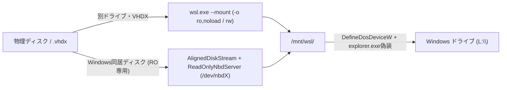

# 概要・開発背景・既存手法との比較 (`WslMountDrive`)

本ドキュメントでは、**WslMountDrive** を開発した背景、技術アプローチの比較検討結果、技術的な柱、および実践的なユースケースを整理します。

## 1. 開発背景と解決したい課題

Windows 11 環境から別ドライブやデュアルブート環境・仮想ディスク（`.vhdx`）に格納された Linux パーティション（`ext4` / `btrfs` / `xfs` 等）を参照・操作したい場合、従来の手法には以下の課題がありました。

- **課題 1（外部ドライバ依存と安全性リスク）**: サードパーティ製カーネルドライバや WinFsp / Dokan ベース実装は、ドライバ署名・導入手順の負担や、Btrfs / XFS / ext4 拡張機能に対する互換性不足・データ破損リスクが伴います。
- **課題 2（`wsl --mount` 手動運用の落とし穴）**: Windows 11 標準の `wsl --mount` は強力である一方、そのままドライブレターとしてエクスプローラーへ公開しようとすると、Plan 9 Network Provider（`p9np.dll`）の 2 階層パス制限（エラー 64 / 67）、UAC セッション分離、未クリーン終了 ext4 のジャーナル再生、`wsl --unmount` 順序によるデッドロック、さらに Windows 同居ディスクの `ERROR_SHARING_VIOLATION` など複数の OS 固有問題に直面します。
- **技術的アプローチ**: Windows 11 標準の WSL2 Linux カーネルドライバを活用しつつ、生読み取りによる事前スーパーブロック解析、トークン偽装による `DefineDosDeviceW` マッピング、ステートレスなマルチパーティション制御、および Windows 同居ディスク向けの Read-Only NBD ブリッジを統合しました（詳細は [adr/README.md](adr/README.md) を参照）。

## 2. 既存手法・代替案との比較

Windows 11 環境で Linux パーティションを安全にマウントするにあたり、以下の 3 つの主要アプローチを比較検討しました。

| 比較項目 | **案 A: `LTRData.DiscUtils.Ext` + `DokanNet` (C#)** | **案 B: WSL2 (`wsl --mount`) + ドライブ割当【採用】** | **案 C: `libext2fs` + `Dokan` (C/C++)** |
| :--- | :--- | :--- | :--- |
| **Linux カーネル互換性** | ○ 一般的な ext4 は対応（一部拡張機能に制約） | **◎ 100%（本物の Linux カーネルドライバ）** | ◎ 非常に高い（e2fsprogs 公式ライブラリ） |
| **対応ファイルシステム** | ext2 / ext3 / ext4 のみ | **◎ ext4 / btrfs / xfs 等カーネル標準 FS 全般** | ext2 / ext3 / ext4 のみ |
| **外部ドライバ導入** | Dokan / WinFsp のインストールが必要 | **◎ 不要（Windows 11 + WSL2 標準機能のみ）** | Dokan / WinFsp のインストールが必要 |
| **書き込み保護・RW 柔軟性** | C# コード側で制御 | **◎ Linux カーネルの `ro,noload`（既定） / `rw` 切替** | C コード側で制御 |
| **Windows (`C:` 等) と同居する物理ディスクの別パーティション** | ◎ マウント可能 | **◎ マウント可能**（`AlignedDiskStream` ＋ WSL2 カーネル NBD Read-Only 専用ブリッジで対応） | ◎ マウント可能 |
| **同一の別物理ディスク（または `.vhdx`）内の複数パーティション同時マウント** | ◎ マウント可能 | **◎ マウント可能**（パーティション単位のセッション管理＋個別/一括アンマウント制御で対応） | ◎ マウント可能 |
| **開発・保守の容易さ** | ◎ NuGet のみで完結 | **◎ 非常にシンプルかつ堅牢** | △ C ライブラリの Windows ビルドが必要 |

**採用理由（案 B）**: サードパーティ製カーネルドライバ（BSOD リスクやドライバ署名問題）を一切導入せずに、Linux カーネル本体のファイルシステムドライバによる 100% の互換性と安全な既定 Read-Only（`ro,noload`）、および必要時の Read-Write（`rw`）両対応を実現できるため採用しました（[ADR-0001](adr/0001-wsl2-mount-over-user-mode-fs-drivers.md)）。

### データパス比較



## 3. 技術的な柱

1. **安全な既定 Read-Only 保護（Safe by Default）**: 明示的な `--rw` / GUI チェックがない限り `ro,noload`（未対応 FS は `ro`）でマウントし、ハイバネーション中や強制終了後の Dirty な ext4 でもディスク書き込みを行いません。
2. **OS 境界の完全自動化**: `p9np.dll` の制限を `DefineDosDeviceW` で回避し、UAC 分離を `explorer.exe` トークン偽装で透過化するため、レジストリ（`EnableLinkedConnections`）変更や再起動が不要です。
3. **CLI・GUI ハイブリッド運用**: スクリプト・自動化向けの `WslMountDrive.Cli` と、視覚的な一覧・ドラッグ＆ドロップ・タスクトレイ常駐を備えた `WslMountDrive.App` を同一コアライブラリ（`WslMountDrive.Core`）上で提供します。

## 4. 実践ユースケース

### ユースケース 1: デュアルブート / 別ドライブ上の Linux データを Windows から安全に読み取る

- **対象環境**: Windows 11 + WSL2、別 SSD/HDD または同居ディスク上の ext4/btrfs/xfs パーティション
- **手順 / コマンド例**:
  ```powershell
  WslMountDrive.Cli.exe list
  WslMountDrive.Cli.exe mount --disk 1 --partition 2 --letter L:
  ```
- **注意点**: Windows が使用中の物理ディスク（`C:` と同居等）では安全のため Read-Only NBD ブリッジが自動選択され、`--rw` は使用できません。

### ユースケース 2: 仮想ディスク（`.vhdx`）や別ドライブ上の Linux パーティションへ読み書きする

- **対象環境**: Windows 未使用の物理ディスク、または `.vhdx` イメージ
- **手順 / コマンド例**:
  ```powershell
  WslMountDrive.Cli.exe mount --vhd C:\VMs\data.vhdx --partition 1 --letter L: --rw
  ```
- **注意点**: RW マウント後は `WslMountDrive.Cli.exe unmount --letter L:` で必ず安全にアンマウントしてからディスクや `.vhdx` を取り外してください。
